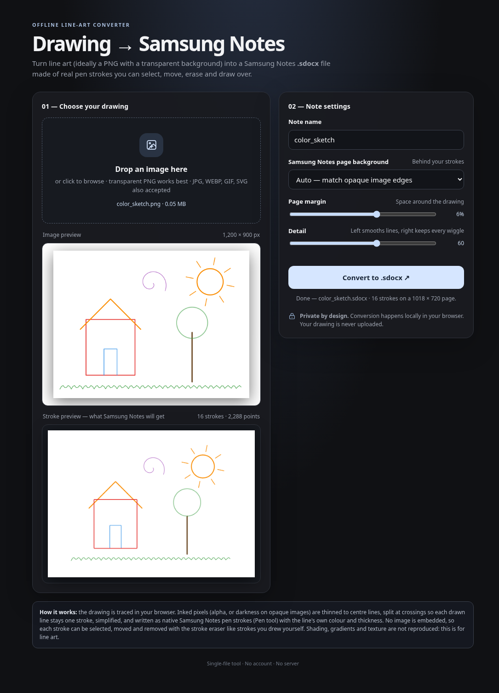

# [drawconvert](https://azp3001.github.io/drawconvert/)

Turn line art into real, editable **Samsung Notes** pen strokes.

Drop in a PNG and download a `.sdocx` note. In Samsung Notes the lines are normal pen strokes: select them, move them, erase them and draw over them, the same as importing line art in Ibis Paint X. Nothing is embedded as an image, and nothing is uploaded: the converter is a single HTML file that runs in your browser.



## Use it

1. Open **https://azp3001.github.io/drawconvert/** in Chrome or Edge, on a computer or on the phone. You can also download `index.html` and open it locally; it works offline. Either way, nothing is uploaded.
2. Drop a PNG on it, or click to pick one. A transparent background works best; drawings on any plain paper colour (white, cream, grey, black) work too, in any ink colour. The note page takes the picture's background colour by default.
3. Check the **stroke preview**. It is what Samsung Notes will show.
   - **Compare**: drag across the preview. Left of the divider is your picture, right of it the strokes, in the same place on the page.
   - **Accuracy** under it: how closely the strokes reproduce your picture, at the picture's own resolution (the ink both share over all the ink in either, weighted by strength; 100% = identical). The picture's ink is measured against its own paper colour, lines a pixel off still match, and paper grain is ignored. It scores the preview, so the Pencil's grain on the phone isn't counted.
   - **Detail**: left smooths the lines, right follows every wiggle.
   - **Page margin**, **page background** and **note name** work as you'd expect.
4. Click **Convert to .sdocx**, copy the file to the phone and open it in Samsung Notes (My Files, tap the file).

Images with a long side over 2048 px are scaled down before tracing.

## How it works

1. **Ink:** alpha for transparent images, distance from the paper colour for opaque ones. A photo of a page is evened out first: the paper's lighting and tint are fitted as a smooth surface and divided out, so the paper reads as white and its shadows don't turn into shading. Images under 1600 px are traced on a bicubic enlargement (up to 8×), so thin and low-resolution lines get sub-pixel centres and widths. On small images (enlarged 4× or more) fainter lines right next to dark ones still count as ink, since lines there sit about a pixel apart.
2. **Shading:** broad, light, even ink (gradients, flat tones, pencil grain) is separated from the lines (crowded line work, which mixes paper and ink, stays lines) and hatched with the *Pencil* (Pencil2): 45° strokes that tile the area, each with the alpha of the tone under it. Lines over shading are measured on their own, with the shading taken out.
3. **Centre lines:** distance transform, then thinning to one-pixel skeletons.
4. **Lines:** the skeleton becomes a graph, and at every crossing the straightest branches of the same colour are joined. A drawn line stays one line through the lines it crosses.
5. **Width and colour:** measured across the line on a non-ringing (bilinear) enlargement, stopping at the dip before a neighbouring line so close lines don't widen each other. Even lines get one width; tapered lines keep their profile, and line ends are placed by the ink area they cover. The colour is the median of the line's own pixels. Where a line fades out, it keeps its opacity point by point.
6. **Strokes:** smoothed (sharp corners stay sharp), simplified (Ramer-Douglas-Peucker, with a tolerance fixed on the page) and written as Samsung Notes *Pen* (InkPen2) and *Pencil* (Pencil2) strokes, with the checksums the app expects. On the phone a Pen stroke ignores pressure and narrows to about half when drawn fast, but keeps its full width when drawn slowly (measured from phone screenshots, [FORMAT.md](FORMAT.md) §8). So strokes are written slowly, an even line is one Pen stroke, and a taper is a run of shrinking pieces. Pencil alpha is chosen from the measured tone its grain lays down. Semi-transparent ink and fading ends are drawn in the colour they show on the page, so the joints don't darken, and lighter pieces go under darker ones.

The `.sdocx` stroke format was reverse-engineered from real notes. [FORMAT.md](FORMAT.md) has the layout with byte offsets.

## Tests

You need Node.js 22 or newer. The browser test also needs Chrome or Chromium, and regenerating the fixtures needs Python 3 with pycairo.

```sh
node tests/run_tests.js            # full check: samples, fixtures, round trip, rendered comparison
node tests/browser_smoke.js        # drives the page in headless Chrome (CHROME=/path/to/chrome)
node tests/sdocx_parser.js *.sdocx # decodes any .sdocx and verifies its hash chain
python3 tests/make_fixtures.py     # redraws tests/fixtures/*.png
node tests/make_calibration.js     # writes tests/out/calibration.sdocx, a device test page (see Limits)
```

`run_tests.js` checks that:

- the parser decodes the three sample notes (`Notes_*.sdocx`, `Test_*.sdocx`), checksums included;
- every fixture converts to a `.sdocx` whose structure matches the real notes, with no image layer, and each Pen or Pencil stroke carries the fields of that pen's sample strokes;
- every stroke round-trips (points, bounding box, colour, size, pressure);
- the strokes, rendered back as the phone draws them (Pen width, Pencil tone; FORMAT.md §8), match the source PNG (IoU above 0.85; 0.8 for 1 px lines and hatched shading, 0.6 for quarter-size inputs scored against the full-size drawing);
- shading comes out as Pencil strokes whose composited tone is within 0.03 of the source, and line art uses no Pencil at all;
- no stroke crosses bare paper;
- each drawn line is traced as one line.

Converted notes, renders and diff images are written to `tests/out/`.

## Deployment

GitHub Pages serves this repository straight from the `main` branch, so every push updates the live converter within a minute or two. One-time setup: Settings → Pages → Source: **Deploy from a branch** → `main` / `(root)`.

## Limits

- Shading comes out as Pencil hatching in 10% tone steps. Its tone is calibrated on the phone, but the grain isn't drawn in the preview, and the Pencil can't go darker than about 73%.
- Solid dark fills come out as thick centre lines, not fills.
- Photos of pencil drawings come out as hatching: tone is matched, but fine pencil texture and lines inside the shading are mostly lost (about 57 % accuracy on a test photo).
- Below about 2 px, a line's opacity can't be told from its width. Such lines are drawn as thin, opaque lines in the ink colour, so a thin translucent line comes out thinner and stronger than it was. On paper (no transparency) a thin coloured line can come out a little over-saturated. A fade on such a line becomes a taper.
- A line gone over twice, with paper showing between the passes, can come out as several short strokes.
- Tracing runs on the page's main thread, so a 2048 px image pauses it for about a second.
- A tapering or fading line is a chain of short strokes, so the stroke eraser removes one piece at a time. Use the lasso to select or delete a whole line.
- The Pen and Pencil rules come from screenshots of one phone. `node tests/make_calibration.js` writes `tests/out/calibration.sdocx` to re-check another device.

## Credits and license

MIT, see [LICENSE](LICENSE). The note and page container code is adapted from [Dietrich](https://github.com/Downhillghost/Dietrich) (MIT, © 2026 Dietrich contributors).

Not affiliated with Samsung. Samsung Notes is a trademark of Samsung Electronics.
